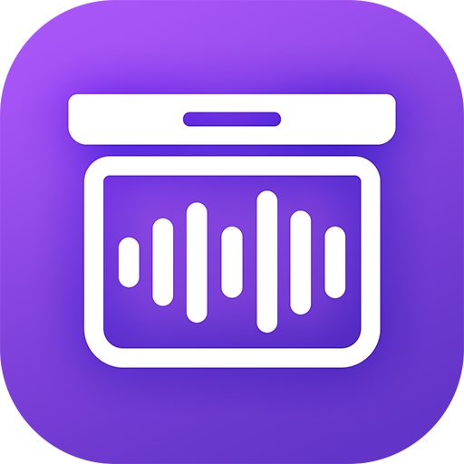

  

<h1 align="center">SoundCrate</h1>

A local music player for the music you own, with optional support for your own server.

  <a href="https://github.com/RbgPro4/SoundCrate/releases/latest"><b>⬇ Download for Windows</b></a>

  
  

## Features
- FLAC and high-sample-rate playback with an equalizer
- Queue with live positions and drag-free reordering
- Organize libraries and rename files to match the order you set
- Stream from your own SoundCrate server, with disk caching
- Automatic updates

## Screenshots

## Install
1. Download the installer from the Releases page.
2. Run it. SoundCrate updates itself after that.
